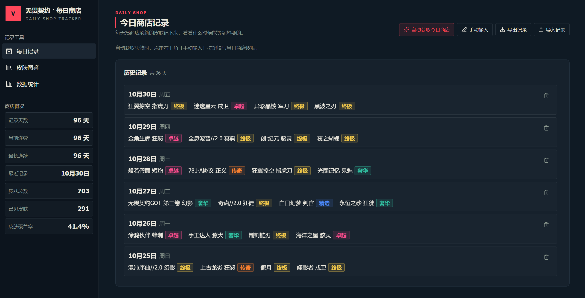
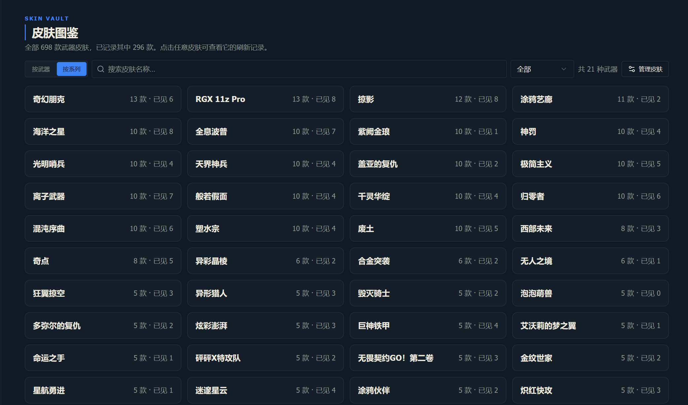
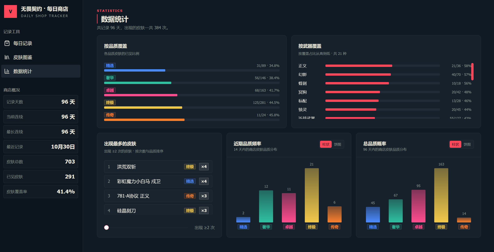
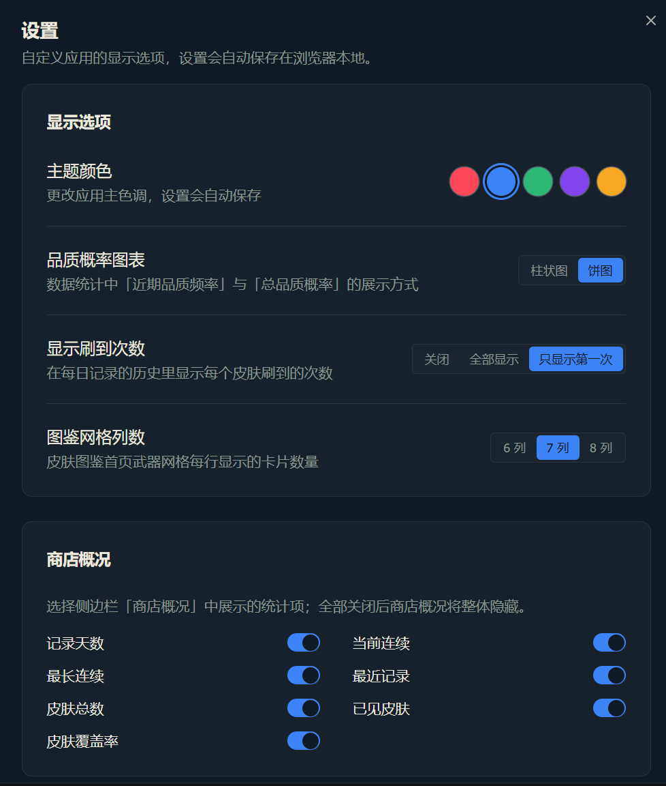

# 无畏契约(国服)每日商店记录

一个本地运行的《无畏契约》国服每日商店记录工具：记录每日商店刷新的皮肤、统计刷到过的皮肤与品质分布、维护完整的皮肤图鉴。数据保存在浏览器本地，无需后端，下载解压即可使用。

## 界面预览









## 快速开始

1. 下载本项目并解压
2. 双击文件夹根目录的 **`无畏契约商店记录.html`**，浏览器中即可使用（无需安装任何软件）

> ℹ️ `index.source.html` 是源码工程的入口（供开发者查看），直接双击会显示提示页，请忽略。

功能包括：

- **每日商店记录**：手动输入当日商店皮肤；也可以直接点「自动获取今日商店」——**网页会自动启动「商店自动获取器」并在后台静默运行，无需手动打开 cmd**，获取完成后自动入库
- **设置中心**：主题颜色（红 / 蓝 / 绿 / 紫 / 黄）、统计图表模式（柱状图 / 饼图）、历史刷到次数显示方式（关闭 / 全部显示 / 只显示第一次）、图鉴网格列数（6 / 7 / 8 列）、商店概况开关（记录天数 / 当前连续 / 最长连续 / 最近记录 / 皮肤总数 / 已见皮肤 / 皮肤覆盖率），设置自动保存在浏览器本地
- **自动收录新皮肤**：自动获取时若商店出现图鉴中没有的新皮肤，自动加入图鉴并提示
- **数据统计**：品质覆盖 / 武器覆盖、出现最多的皮肤、近期品质频率、总品质概率、连续记录统计
- **皮肤图鉴**：内置 698 款国服皮肤（武器、品质、点券价），支持**按武器 / 按系列**两种视图（近战武器按所属系列归入，找不到系列的整合为「其他」），武器卡片拖拽排序、搜索、品质与已见/未见筛选、心愿单（抽中金色粒子庆祝特效）
- **数据本地存储**：记录、心愿单、自定义皮肤、武器排序均存于浏览器本地，支持 JSON 导入/导出备份

## 配合「商店自动获取器」使用

自动获取今日商店需配合本项目的姊妹项目 **无畏契约每日商店自动获取器**（另见其仓库）：

1. 双击本项目的 `无畏契约商店记录.html`，进入「每日记录」页
2. 点「自动获取今日商店」，浏览器会尝试唤起本机已注册的自动获取器（首次唤起时浏览器会弹出「打开」确认窗口，点击「打开」即可）
3. 自动获取器在后台静默启动，当天 4 款皮肤自动入库；之后再次点击不会重复启动
4. 首次使用自动获取器前，需先用手机 QQ 扫码登录一次

## 数据说明

- 皮肤基础数据：698 款国服皮肤，字段包含名称 / 武器 / 品质 / 点券价（已剔除通行证、活动、特工及不会出现在每日商店的限定系列皮肤）
- 品质体系：精选 / 奢华 / 卓越 / 终极 / 传奇
- 所有记录数据保存在浏览器 localStorage，仅存于本机

## 目录结构

```
无畏契约商店记录.html  # 网页成品（双击即用，含皮肤数据与图标）
data/             # 网页成品配套的皮肤数据
icons.svg         # 网页图标
assets/           # README 预览截图
public/data/      # 皮肤数据（源码用）
scripts/          # 数据整理脚本
src/              # 网页源码
```

## 免责声明

本项目为个人学习用途，数据来源于公开渠道整理，与拳头游戏 / 腾讯无关。游戏内容版权归原作者所有。
